# Mikhail Bovt

AI engineer working across machine learning, backend systems and deployment.

<picture>
  <source media="(max-width: 600px) and (prefers-color-scheme: dark)" srcset="./assets/seam-compact-dark.svg">
  <source media="(max-width: 600px)" srcset="./assets/seam-compact-light.svg">
  <source media="(prefers-color-scheme: dark)" srcset="./assets/seam-wide-dark.svg">
  
</picture>

## Selected work

### 01 / [Vyach](https://vyach.app)

Discord meeting assistant for transcription, summaries and questions about past conversations. Co-developed; my work focuses on the backend, AI pipeline and infrastructure.

### 02 / [Stillwatch](https://github.com/mikhailbovt/stillwatch)

Video-event triage combining local detection, retained event context and cloud assessment. A preview for supervised evaluation, with a Python SDK.

### 03 / [EvoGenesis](https://evogenesis.bio)

Research into reconstructing damaged protein-coding sequences with machine learning and biological constraints. Candidate repairs are checked for reading-frame validity, translation and orthology consistency.

### 04 / [FORMA](https://github.com/mikhailbovt/FORMA)

Self-hosted resume editor with live preview and PDF, DOCX and JSON export. Built with Go, React and PostgreSQL; AI review is optional.

**Tools** · Python · Go · TypeScript · R · PostgreSQL · Docker

[Email](mailto:tripsov@gmail.com) · [LinkedIn](https://linkedin.com/in/mikhail-bovt-7366ba281/)
